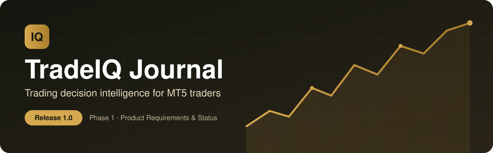
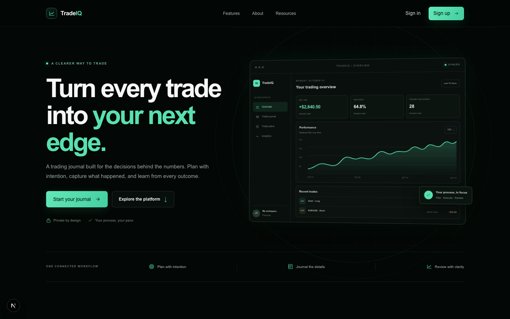
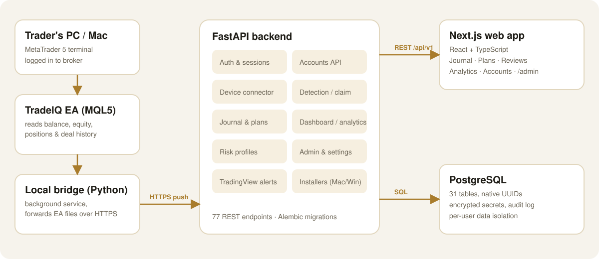
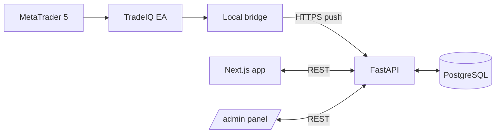
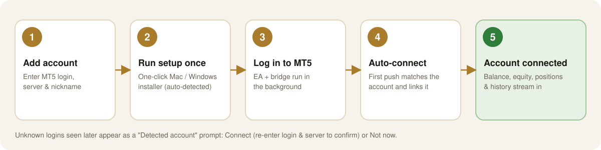
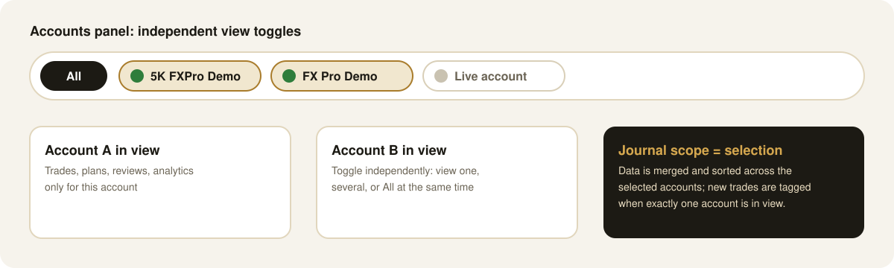
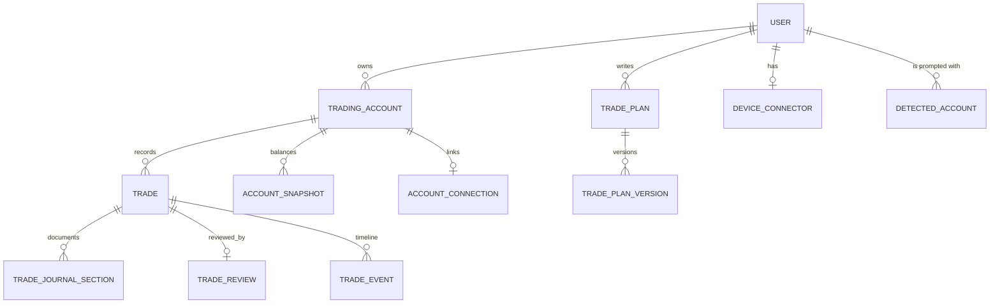

<p align="center"></p>

# TradeIQ Journal — Release 1.0 (Phase 1)

> **Product Requirements & Status Document** · Version 1.0
> A trading journal that records *why* trades were taken, not just what they returned, and connects to MetaTrader 5 with almost no manual work.

📑 **Presentation version:** [TradeIQ-v1.0-Presentation.pdf](./TradeIQ-v1.0-Presentation.pdf)

---

## 1. Vision

Most journals log closed trades. TradeIQ keeps the whole decision story in one place:

| Layer | Question it answers | Where it lives |
|---|---|---|
| **Market facts** | What did the terminal report? | MT5 sync: balance, equity, positions, deals |
| **Trader intent** | What was planned? | Trade plans with versions |
| **Behaviour** | What did I actually do and learn? | Timestamped journal sections and reviews |

Core promise: preserve decision timing, reconcile trading records, and judge process quality before interpreting profit.

<p align="center"></p>

## 2. Who it is for

- **Discretionary MT5 traders** who want structured reviews and plan-vs-execution evidence.
- **Traders with several accounts** (demo, prop, live) who need each account's journal kept separate.
- **The platform admin**, who controls how accounts are connected and watches platform health.

## 3. Release 1.0 at a glance

| | |
|---|---|
| **Frontend** | Next.js, React, TypeScript (`web/`) |
| **Backend** | FastAPI, SQLAlchemy, Alembic (`backend/`) |
| **Database** | PostgreSQL, 31 tables, 13 migrations |
| **MT5 link** | MQL5 Expert Advisor, local bridge, one-click installers; MetaApi as an optional hosted method |
| **API** | 77 REST endpoints under `/api/v1` |
| **Tests** | 33 backend tests, all passing |

## 4. Architecture

<p align="center"></p>



## 5. Features delivered

### 5.1 Journal workflow
- **Trade plans** captured before execution, with version history and explicit discard (no-exposure) state.
- **Trade journal** with timestamped setup, emotion, execution and management sections, search and outcome filters. Section content accepts both objects and lists.
- **Post-trade reviews** for plan adherence, learning and next action; review coverage is tracked.
- **CSV export** of the current filtered journal.

### 5.2 Dashboard and analytics
- Net P&L, win rate, profit factor and review coverage with all-time, 7/30/90-day and custom ranges.
- Equity curve, performance by strategy and session, risk analytics.
- P&L calendar (month and year views) with daily and weekly totals and timezone-aware grouping.

### 5.3 Accounts and automatic MT5 connection

<p align="center"></p>

1. The user adds an account (login, server, nickname).
2. The wizard detects Mac or Windows and offers a personalised one-click installer. It installs and compiles the EA, writes its settings, starts the bridge as a background service and relaunches MT5.
3. The user logs in to MT5. The first push is matched to the account and the status becomes **Account connected** automatically.
4. Balance, equity, open positions and history appear on the account card and in the journal.

The installer is run **once per computer**. The connector secret is stable (stored hashed for authentication and encrypted so installers can be re-issued), so later accounts need no reinstall.

### 5.4 Multiple accounts
- **Auto-detection:** logging in to a new account in the same MT5 creates a *Detected account* prompt. The user chooses **Connect** (re-entering login and server to confirm) or **Not now**.
- **Independent view toggles:** each account has its own pill in the Accounts panel, plus an **All** chip. Any combination can be in view at once; the journal, plans, reviews and analytics follow the selection.
- Plans and trades are tagged to an account when exactly one is in view, so histories never mix.
- Only the account currently logged in to the terminal streams live data; others keep their last data and show offline after 10 minutes without a push.

<p align="center"></p>

### 5.5 Admin panel (`/admin`)
- Platform statistics: users, accounts, connected, failing, trades, deals.
- Platform default MT5 method (EA or MetaApi) and per-user overrides; switching a user disconnects accounts of the other method.
- User and account search.

### 5.6 Integrations
- **MT5 EA + bridge** (primary method, works when MT5 blocks WebRequest, error 4014, via the file bridge).
- **MetaApi hosted sync** (implemented; requires an active MetaApi plan and `METAAPI_TOKEN`).
- **TradingView alerts** via a per-user webhook token, with matching alerts to trades.

### 5.7 Security
- Session-cookie authentication; per-user data isolation on every query.
- Broker credentials and connector secrets encrypted at rest; webhook secrets hashed.
- Audit log table and per-account ownership checks (`get_owned_account`).

## 6. Data model (summary)



Other tables: preferences, trader profile, risk profiles and rule sets, MT5 orders/deals/positions, sync runs, TradingView alerts, screenshots, notifications, audit log, platform settings.

## 7. Quality status

| Area | Status |
|---|---|
| Backend unit/integration tests | ✅ 33 passing |
| Type check and lint (frontend) | ✅ clean |
| Database migrations applied to dev DB | ✅ |
| Live MT5 on macOS (EA + bridge + auto-connect) | ✅ verified with two FxPro demo accounts |
| Windows installer | ⚠️ implemented, not yet validated on a Windows machine |
| MetaApi hosted sync | ⚠️ implemented, blocked by MetaApi billing |
| Production deployment (public HTTPS, monitoring) | ⏳ not started |

## 8. Known limitations in 1.0

- `PUBLIC_API_URL` defaults to localhost; real users need a public HTTPS URL.
- One MT5 terminal logs in to one account at a time, so only that account is live.
- Account-rule evaluation, object-storage screenshot uploads and live (push) UI updates are not complete.
- Rate limiting and password-recovery flows are not yet in place.
- Imported MT5 deals are not yet fully reconciled into journal episodes.

## 9. Roadmap (Phase 2 candidates)

1. Public deployment: HTTPS, managed PostgreSQL, monitoring, backups.
2. Windows installer validation and signed installers.
3. Account-rule engine (drawdown, daily loss) with alerts.
4. Deal-to-journal reconciliation and screenshot storage.
5. Live updates over WebSocket or SSE.
6. Auth hardening: rate limits, email verification, recovery.
7. AI-assisted review summaries and behavioural pattern detection.

## 10. Run it locally

```bash
bash backend/start-dev.sh        # PostgreSQL, migrations, API on :8000
cd web && npm ci && npm run dev  # app on :3000
```

Details, admin creation and the MT5 notes are in [DEVSTART.md](../../DEVSTART.md). The integration guide is in [docs/](../../docs/).

---

<sub>TradeIQ Journal · Release 1.0 · Phase 1 documentation. Figures such as endpoint, table and test counts were taken from the codebase at release time.</sub>
