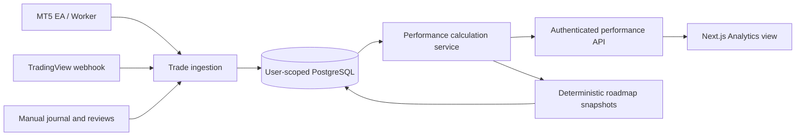

# TradeIQ Journal - Release 2.0

> **Product Requirements, Architecture and Delivery Status**
>
> Version 2.0 - Analytical Intelligence Layer

## 1. Vision

TradeIQ 2.0 turns a trader's own execution history into a measurable improvement
system. The platform remains a private journal and execution record, but adds a
user-scoped **Performance Agent** that explains where the trader has an observed
edge, where process quality is deteriorating, and what to test next.

This is not a generic chatbot and it does not compare a trader with a shared
population. Every result is calculated from the authenticated user's records,
within the selected account and date scope. The system prioritizes risk-normalized
evidence and explicitly separates descriptive observations from causal claims,
financial advice, or statistically proven conclusions.

## 2. Release objectives

| Objective | Requirement |
|---|---|
| Personal intelligence | Calculate insights only from the signed-in user's trades, journal context, reviews, tags and account records. |
| Edge measurement | Make expectancy in R, profit factor, payoff distribution, drawdown and execution quality visible before vanity metrics. |
| Strategy discovery | Rank strategies and setups using consistent cohorts and sample-size warnings. |
| Behaviour detection | Surface associations involving emotion, rule breaks, tags, plan adherence, timing and trade context. |
| Actionable improvement | Generate a deterministic, reviewable roadmap with focus areas, recommendations, confidence and progress tracking. |
| Safe integration | Preserve existing journal, account, MT5, TradingView and review workflows without duplicating the trade store. |
| Backend-first delivery | Establish ownership checks, schemas, calculations, migrations and tests before relying on frontend presentation. |

## 3. Users and primary journeys

### 3.1 Trader

1. Connects MT5, receives TradingView alerts, imports trades or records a trade manually.
2. Adds a strategy, setup, confluences, emotional state, rule-break labels and review context.
3. Opens **Analytics** and selects all accounts, one account or the existing date range.
4. Reviews the Edge Snapshot, strategy ranking and current roadmap.
5. Saves a roadmap snapshot and updates its status as the experiment progresses.
6. Repeats the review after more trades are recorded and compares the new evidence with
   the previous recommendation.

### 3.2 Platform administrator

The administrator can monitor platform health and connection state through the existing
admin surface. V2 performance records remain user-owned; administrative access does not
change the ownership rules used by the performance API.

## 4. Scope of the Performance Agent

### 4.1 Edge Snapshot

The always-visible summary includes:

- Expectancy in R, calculated only from recorded R-multiples.
- Profit factor where the selected scope has a comparable currency.
- Win rate paired with win/loss counts.
- Average win and average loss in R.
- Maximum cumulative-R drawdown.
- Drawdown recovery duration, or an explicit unrecovered state.
- Average holding time.
- Average recorded MAE and MFE with coverage counts.
- R-multiple sample size and missing-data warnings.

### 4.2 Strategy and setup analysis

Each strategy and setup cohort reports:

- Number of closed trades.
- Number of wins, losses and flat outcomes.
- Win rate.
- Profit factor when currency-safe.
- Expectancy and average win/loss in R.
- Maximum drawdown contribution.
- Average holding time.
- Available MAE/MFE coverage.
- Sample-size and missing-R warnings.

The UI ranks strategies by observed expectancy. A strategy is not highlighted as a
reliable top observed edge until it has at least 30 recorded R-multiples. This threshold
is a descriptive reliability guard, not a guarantee of future performance.

### 4.3 Behaviour and execution cohorts

The analytics service can group results by:

- Explicit emotional state.
- Explicit confluence labels.
- Rule-break labels and their associated outcomes.
- User journal tags.
- Review plan-adherence values.
- Hour of day and weekday in the requested timezone.
- Trades opened within a configured interval after a prior closed loss.

The post-loss timing signal is named a **timing flag**, not proof of revenge intent.
Behavioural cohorts are associations and should be reviewed with the trader's notes and
trade context before changing a rule.

### 4.4 Roadmap generation

The roadmap service produces deterministic recommendations from available evidence,
including:

- Insufficient sample or R coverage.
- Negative or weak expectancy cohorts.
- Repeated rule-break associations.
- Recorded MAE/MFE coverage opportunities.
- Review and process-adherence gaps.
- Timing patterns that deserve a controlled test.

Each recommendation includes a priority, focus area, recommendation text and confidence.
Roadmaps can be persisted per user, reopened later and marked `pending`, `in_progress`,
`completed` or `adjusted`, with progress notes.

## 5. Data and ownership model

V2 extends the existing trade record rather than creating a parallel analytics database.
The following optional analytical context is stored on `Trade`:

| Field | Purpose |
|---|---|
| `setup` | Separately named setup or pattern within a strategy. |
| `stop_loss` | Recorded stop price or planned stop context. |
| `take_profit` | Recorded target price or planned target context. |
| `mae_r` | Maximum Adverse Excursion in R, when measured by the integration or trader. |
| `mfe_r` | Maximum Favorable Excursion in R, when measured by the integration or trader. |
| `emotional_state` | User-provided state at entry or during management. |
| `confluences` | User-provided confluence labels. |
| `rule_breaks` | User-provided process or rule-break labels. |

The `PerformanceRoadmap` record stores:

- Owning user.
- Optional account scope.
- Inclusive date scope and timezone.
- Generated recommendations.
- Metrics snapshot used to generate the roadmap.
- Progress status and notes.
- Creation and update timestamps.

### 5.1 Isolation rules

1. The authenticated session determines the user identity.
2. No performance endpoint accepts a caller-supplied `user_id`.
3. Every trade, review, tag, plan and roadmap query is filtered to the authenticated user.
4. An `account_id` filter is accepted only after ownership validation.
5. All-account results are aggregated only across the requesting user's accounts.
6. Roadmap read, create and update operations verify roadmap ownership.
7. No external LLM or model provider receives user trade or journal data in this release.

## 6. API contract

All routes are authenticated and mounted under `/api/v1`.

| Method | Endpoint | Purpose |
|---|---|---|
| `GET` | `/performance/edge-snapshot` | Core metrics and data-quality warnings. |
| `GET` | `/performance/strategies` | Strategy cohorts and ranking. |
| `GET` | `/performance/setups` | Setup cohorts and ranking. |
| `GET` | `/performance/behavior` | Emotion, rule-break, tags, adherence and timing cohorts. |
| `GET` | `/performance/time` | Hour and weekday cohorts. |
| `GET` | `/performance/roadmap` | Generate the current deterministic roadmap. |
| `POST` | `/performance/roadmaps` | Save a roadmap snapshot. |
| `GET` | `/performance/roadmaps` | List the signed-in user's saved roadmaps. |
| `PATCH` | `/performance/roadmaps/{roadmap_id}` | Update roadmap progress and notes. |

The analytics endpoints support:

- `account_id`
- `start_date`
- `end_date`
- `timezone`

Date boundaries are inclusive in the requested timezone. Invalid or foreign account
references are rejected rather than silently treated as all accounts.

## 7. Metric definitions and safeguards

### 7.1 R-normalized results

Expectancy, average win, average loss and drawdown use recorded R-multiples. Trades
without a valid R-multiple remain in trade counts but are excluded from R averages and
receive coverage warnings.

### 7.2 Currency handling

Profit factor and currency-denominated aggregation are suppressed when the selected
scope combines incompatible account currencies. The API does not silently add USD,
EUR or other account currencies together.

### 7.3 Drawdown and recovery

Maximum drawdown is calculated from the chronological cumulative-R sequence. A drawdown
that has not returned to its prior peak has no recovery duration and is reported as
currently unrecovered.

### 7.4 MAE and MFE

MAE and MFE are calculated only from values explicitly recorded by an integration or
the user. They are not inferred from entry and exit prices because historical
intratrade paths cannot be reconstructed reliably from those two values.

### 7.5 Sample quality

The service reports trade count, R coverage and missing-context warnings. Small cohorts
are shown as observations and are not represented as statistically reliable edges.

### 7.6 Position sizing

Position-size leak detection is not inferred from lot size and stop distance. Reliable
calculation requires broker contract specifications and verified account equity at entry.

## 8. Backend architecture



Implementation locations:

- [`backend/app/services/performance.py`](../../backend/app/services/performance.py) -
  calculation service, cohort loading, drawdown, coverage and timing logic.
- [`backend/app/api/performance.py`](../../backend/app/api/performance.py) -
  authenticated API routes and roadmap persistence.
- [`backend/app/platform_models.py`](../../backend/app/platform_models.py) -
  trade context fields and `PerformanceRoadmap`.
- [`backend/app/schemas.py`](../../backend/app/schemas.py) -
  trade context and roadmap progress schemas.
- [`backend/app/api/trades.py`](../../backend/app/api/trades.py) -
  persistence of analytical trade context.

## 9. Database migrations

V2 requires both migrations:

1. `b4c7e1d09a53_performance_context_fields.py`
   - Adds setup, stop, target, MAE, MFE, emotional state, confluences and rule-break
     fields to `trades`.
2. `b4c7e1d09a54_saved_performance_roadmaps.py`
   - Adds the `performance_roadmaps` table and indexes.

Apply migrations before using V2 in a deployed environment:

```bash
cd backend
alembic upgrade head
```

The API does not auto-create production schemas.

## 10. Frontend integration

The Analytics view now combines:

- Existing browser-side summary cards.
- Existing P&L calendar and cumulative P&L chart.
- The V2 Performance Agent panel.

The V2 panel displays:

- Expectancy, profit factor, win rate, maximum drawdown, MAE/MFE and holding time.
- Data-quality warnings.
- Top observed strategies by expectancy.
- Current roadmap focus areas.
- Save-roadmap action.
- Persisted roadmap progress controls.

The selected account is sent to the backend only when one account is selected. Multiple
selected accounts use the user's all-account scope, preserving the existing multi-account
view behavior.

## 11. Quality and acceptance criteria

### Functional acceptance

- [x] Authenticated users can retrieve their own edge snapshot.
- [x] Foreign account and roadmap records cannot be read or modified.
- [x] Strategy and setup breakdowns use the selected user/account/date scope.
- [x] Mixed currencies do not produce misleading combined currency metrics.
- [x] Missing R, MAE or MFE values produce explicit coverage information.
- [x] Drawdown recovery distinguishes recovered and unrecovered states.
- [x] Post-loss timing checks include a prior loss immediately before the date window
      without including that loss in the selected cohort.
- [x] Roadmaps can be generated, saved, listed and progressed.
- [x] Analytics remains usable when no qualifying trades exist.

### Validation status

| Area | Status |
|---|---|
| Backend V2 tests | ✅ 38 passing |
| Focused backend lint | ✅ passing |
| Migration rendering | ✅ current head `b4c7e1d09a54` |
| Frontend lint | ✅ passing |
| Frontend production build | ✅ passing |
| Backend readiness endpoint | ✅ `/readyz` returns `{"status":"ready"}` |
| Frontend HTTP response | ✅ local Next.js server returns HTTP 200 |
| External model provider | ⏳ intentionally not connected in V2 |
| Production deployment and observability | ⏳ not started |

## 12. Known limitations

- The roadmap is deterministic and evidence-based; a natural-language model is not yet
  connected to private user data.
- Strategy and behaviour results are descriptive associations, not causal findings.
- MAE/MFE quality depends on the integration or trader recording those values.
- Position-sizing leak detection requires verified broker specifications and entry equity.
- Journal-language correlation is not yet implemented as a semantic NLP feature.
- Automated weekly report delivery is not yet implemented.
- Comparison views, equity-curve drawdown visualizations and R-distribution charts remain
  follow-on UI modules.
- Production HTTPS, managed PostgreSQL, monitoring, backups and retention policies remain
  deployment work.

## 13. Follow-on roadmap

1. Add a user-scoped R-multiple distribution and equity/drawdown visualization.
2. Add setup, time, behaviour and comparison panels to the Analytics view.
3. Add a controlled journal-language classifier with transparent evidence snippets and
   opt-in processing.
4. Add weekly report generation with progress against the previous roadmap.
5. Add configurable account-rule and position-sizing analysis after broker metadata and
   equity-at-entry are available.
6. Add signed, auditable experiment tracking for roadmap recommendations.
7. Introduce an external model provider only behind explicit consent, strict data
   minimization, tenant isolation and provider-retention controls.

## 14. Local operation

From the repository root:

```bash
bash backend/start-dev.sh
cd web && npm ci && npm run dev
```

The backend runs on `http://localhost:8000` and the frontend on
`http://localhost:3000`. Apply migrations before opening the Analytics view against a
new database. See [`DEVSTART.md`](../../DEVSTART.md) and the
[backend API README](../../backend/README.md) for environment and integration details.

---

<sub>TradeIQ Journal · Release 2.0 · Analytical Intelligence Layer. This document describes
the implemented V2 backend foundation and its current frontend integration status.</sub>

## Frontend surfaces (implemented)

All data comes from the user-scoped `/api/v1/performance/*` endpoints via `usePerformanceData` (`web/app/components/performance-workspace.tsx`).

- **Overview:** Expectancy card, R-equivalent on Net P&L, win-rate sample note, profit-factor colour coding, **Edge Snapshot** (best strategy, leak, top 3 insights, "View full analysis", "Ask Agent"), chart toggle (Net P&L / Cumulative R), **Process Score** (review coverage, rule adherence, journal completeness).
- **Analytics sub-tabs:** Overview (R distribution + roadmap), Strategies (Edge / Neutral / Leak / Building sample, status needs ≥30 recorded R), Time analysis (hour and weekday expectancy), Behavior (timing flag, rule breaks, emotion, plan adherence), MAE/MFE, Agent insights.
- **Reviews:** weekly agent report with a saveable roadmap and progress tracking.
- **Ask Agent drawer:** deterministic answers from the same endpoints; no external AI.
- **Implemented since this status was first drafted:** drawdown shading and chart annotations, bulk tagging, per-plan strategy stats, and separate Strategy Lab, Execution Lab and Risk Intelligence screens.
- **Still open:** day×hour cross heatmap (the API returns hour and weekday separately); chart annotations are not yet linked to review/rule events.

### Update: dedicated sidebar pages
- **Edge Intelligence**, **Strategy Lab** (leaderboard, A-vs-B comparison, confluence cohorts), **Risk Intelligence** (R-based underwater drawdown, rule monitor, post-loss timing) and **Development Roadmap** (saved roadmap, progress, history) are separate sidebar pages.
- **Trade Plans** show past stats for each plan's strategy.
- **Implemented since this status was first drafted:** Execution Lab, Reports, goals/experiments, account-equity drawdown and risk profiles, Journal bulk tagging and "Ask Agent about these trades", and chart drawdown shading.

### Update: Reports
- `GET /api/v1/performance/report?start_date&end_date[&account_id&timezone]` returns the period's metrics, an equal-length previous period, a per-metric comparison, strategy cohorts and limitations. User-scoped; 422 on an inverted range.
- The **Reports** sidebar page has a period selector (7/30/90 days), a comparison table, CSV/JSON download and print.
- Reports are computed on demand, not stored. Persisted snapshots remain open.

### Update: Goals, experiments, Execution Lab, journal tools
- **Goals and experiments (backend)**: `GET/POST /api/v1/development/goals`, `PATCH/DELETE /development/goals/{id}`, and the same for `/development/experiments`. Tables `development_goals` and `development_experiments` (migration `b4c7e1d09a55`). Everything is scoped to the signed-in user; foreign ids return 404. A goal's baseline is captured from the trailing 90 days at creation; progress is recomputed from the user's own closed trades since the goal started. Experiment evidence is computed over its date window with a minimum-trades caveat. Results are descriptive, never causal.
- **Development Roadmap page**: goal cards with progress bars, and experiment forms with hypothesis, rule, linked goal, conclusion.
- **Execution Lab page**: planned R:R vs realised R, target capture, R left after exit (MFE) and rule-clean rate, using only recorded trade fields; missing values show as "—".
- **Trade Journal**: row selection, bulk strategy tagging, and a deterministic "Ask Agent about these trades" summary.
- **Overview chart**: drawdown shading (toggle) and data-derived annotations (deepest drawdown, best single trade) on the P&L / cumulative R chart.
- **Equity history**: `GET /api/v1/performance/equity-history[?account_id&start_date&end_date]` returns per-account series from terminal balance/equity snapshots with drawdown % (never merged across accounts).
- **Risk Intelligence**: true account drawdown, today-vs-limits rule monitor from V1 `/risk/status`, and editable risk limits through V1 `PUT /accounts/{id}/risk-profile`. Limits are flagged, not enforced on the terminal.
- **Execution timeline**: `GET /api/v1/performance/execution-timeline/{trade_id}` merges journal events with linked MT5 orders and deals; shown per trade in Execution Lab.
- **Known gaps**: annotations are not yet linked to review/rule events; position-size leak detection remains unimplemented.

## 15. Admin Control Center

The admin app at `/admin` extends the existing platform admin rather than creating a
second product. It uses the same identity and account records. Admin APIs are under
`/api/v1/admin`; operational queries reuse the existing trading, connection, sync,
review and performance tables.

### Implemented foundation

- **Persisted RBAC**: `admin_roles`, `admin_permissions`,
  `admin_role_permissions` and `user_role_assignments`. The migration creates
  Super Admin, Platform Operations, Data Quality Analyst, Intelligence Administrator,
  Support Agent and Read-only Auditor role definitions. Permission checks run in the
  API. Existing `users.role = 'admin'` remains a compatibility Super Admin identity.
- **Admin MFA**: authenticator-app TOTP enrollment with a scannable QR code (rendered
  in the browser from the `otpauth://` URI, so the secret never reaches a third party,
  with a manual-key fallback); encrypted secret storage through
  the configured credential-encryption service; 6-digit verification; failed-attempt
  lockout; and session-scoped verification that expires after 12 hours. Admin endpoints
  reject privileged sessions without a verified factor. Initial setup returns the
  secret once for manual entry into an authenticator app.
- **Audit trail**: append-only through the application API, with actor, action, target,
  reason, outcome and safe detail fields. Role changes, user suspension/restoration,
  connector-method settings, incidents and MFA setup are recorded.
- **Admin Overview**: live counts for users, accounts, connections, failed sync runs,
  trades/deals and open incidents, with explicit connector error alerts.
- **Users & Workspaces**: limited user/account metadata, role assignment with a reason,
  and suspend/restore access. Suspension revokes active sessions and does not delete
  trading history. Passwords, connector tokens, broker passwords and private journal
  reflections are not returned.
- **Trading Accounts and MT5 Connectors**: account/connector metadata, last sync or
  heartbeat, and redacted diagnostics. Connector freshness is a 15-minute heuristic,
  not an authoritative broker health state.
- **Sync & Reconciliation**: persisted sync-run history and automated candidate
  records for MT5 deals without a matching trade episode. Candidates are explicitly
  labelled potential; the initial UI does not mutate broker or journal records.
- **Journal Quality**: aggregate review, strategy, plan and stop coverage only.
- **Support & Incidents**: create, assign/status-update and resolve operational
  incident records; closing requires a documented reason.
- **Intelligence Operations**: reports that V2 calculations are deterministic,
  per-user and do not use an external model, while clearly reporting that persisted
  analysis jobs/latency/evaluation datasets are not yet implemented.

### API surface currently available

`GET /admin/me`, `/overview`, `/health`, `/accounts`, `/connectors`, `/sync-runs`,
`/reconciliation-issues`, `/journal-quality`, `/intelligence/health`, `/roles`,
`/incidents` and `/audit-logs`; write endpoints cover platform settings, user MT5 method,
role assignment, user status, and incident creation/update. `/admin/mfa/setup`,
`/confirm` and `/verify` form the MFA enrollment and challenge flow.

### Planned follow-on releases and constraints

- **Data Quality & Reporting:** persisted reconciliation issue lifecycle, controlled
  retry/re-fetch and recalculation jobs, safe operational exports, support-case records,
  and richer journal-quality timing/completeness metrics.
- **Intelligence Administration:** versioned strategy taxonomy and aliases, risk-rule
  definitions, reusable development-goal templates, insight provenance and persisted
  analysis runs.
- **Evaluation & Rollout:** versioned test sets, metric reference checks, insight
  evaluation/review, feature flags and controlled rollout.
- Account-scoped role assignments are represented in the schema but the current
  permission resolver supports platform-wide assignments only. The admin interface
  does not expose scoped grants.
- MFA is implemented for admin API access, but external identity-provider integration,
  recovery codes, dual approval, time-limited emergency elevation and security-event
  notifications remain follow-on security work. Do not treat this implementation as
  a substitute for a production security assessment.
- The Operations and Intelligence sections intentionally show “not implemented”
  wherever there is no persisted service data. They do not fabricate queue state,
  model runs or validation results.

### Admin migrations

- `8d4e21a7c901`: role/permission assignments, audit log, incidents and user status.
- `91f2d86c4a10`: encrypted admin MFA material and per-session MFA verification.
